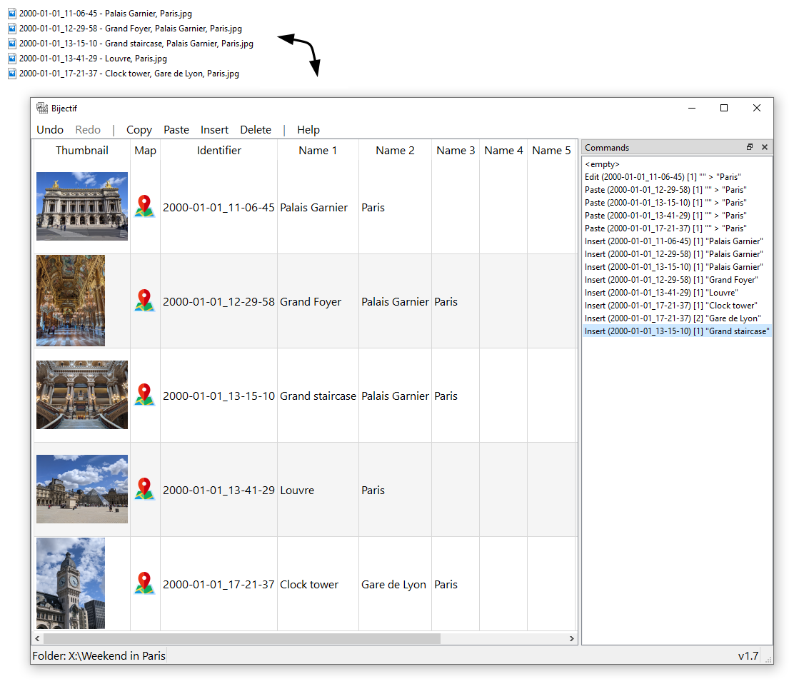

# Bijectif &mdash; Image titles in filenames



## Build

### Arch Linux

Use `PKGBUILD`.

### Debian / Ubuntu

```
sudo apt install cmake make pkg-config g++ libexif-dev libheif-dev \
                 libavcodec-dev libavformat-dev libavutil-dev libswscale-dev \
                 qt6-base-dev qt6-tools-dev libqt6sql6-sqlite
cmake -DCMAKE_BUILD_TYPE=Release . -B build
cmake --build build
ctest --test-dir build/tests --output-on-failure --no-tests=error
```

### Fedora

```
sudo dnf install cmake make gcc-c++ libexif-devel libheif-devel \
                 libavcodec-free-devel libavformat-free-devel libavutil-free-devel libswscale-free-devel \
                 qt6-qtbase-devel qt6-qttools-devel
cmake -DCMAKE_BUILD_TYPE=Release . -B build
cmake --build build
ctest --test-dir build/tests --output-on-failure --no-tests=error
```

### openSUSE

```
sudo zypper install cmake make gcc-c++ libexif-devel libheif-devel \
                    libavcodec-devel libavformat-devel libavutil-devel libswscale-devel \
                    qt6-base-devel qt6-linguist-devel qt6-sql-sqlite
cmake -DCMAKE_BUILD_TYPE=Release . -B build
cmake --build build
ctest --test-dir build/tests --output-on-failure --no-tests=error
```

### Windows

Use `build-msys2.sh` in [MSYS2](https://www.msys2.org/) UCRT64 environment.

## Image formats

More image formats can be read by installing `kimageformats` or `kf6-kimageformats`.

## Settings

Default `bijectif.ini`:

```
thumbnail size = 128
min width = 800
min height = 600
listed extensions = jpg,jpeg,heic,tif,tiff,png,bmp,gif,dng,mp4,mov,avi
image extensions = jpg,jpeg,heic,tif,tiff,png,bmp,gif
video extensions = mp4,mov,avi
max names = 8
max file size = 20
font size = 16
memory cache size = 500
thumbnail database limit = 10000
thumbnail database max unused = 64
log verbosity = 2
resizable columns = false
show command history = false
initial map width = 400
map cache size = 200
```

Example for custom XYZ map tiles provider:

```
[MapTiler Basic]
tiles url = "https://api.maptiler.com/maps/basic-v2/256/{z}/{x}/{y}.png?key=EXAMPLE"
min zoom level = 0
max zoom level = 22
copyright notice = "© MapTiler © OpenStreetMap contributors"
```

See [`settings.h`](src/settings.h).

## License

This project is licensed under the terms of the GNU General Public License v3.0. See `LICENSE`.
